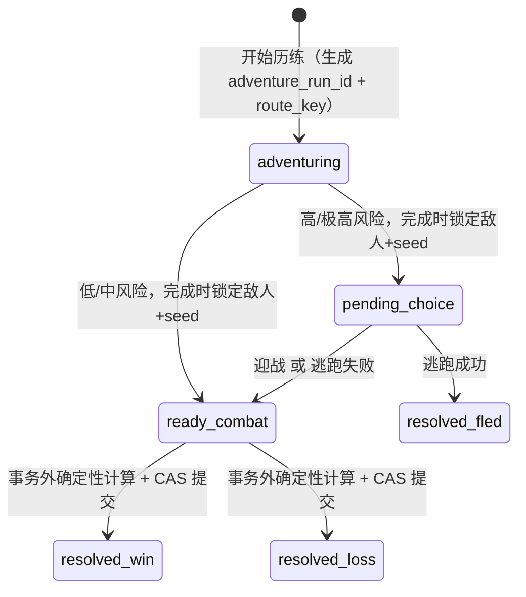

# Technical Design: 普通 PVE 持久结算与逃跑疲劳

## 1. State machine

- 锁定时点唯一：**历练完成、进入结算那一刻**锁定敌人 + RNG；开始时只落 `adventuring` 行（现网 `managers/adventure_manager.py:233` 只存 `route_key`，与之一致）。
- 低/中风险跳过 `pending_choice`，但**绝不跳过持久 settlement**；不允许无记录的同步旁路。
- **仅当人工关掉开关时（`flee.enabled=false`，kill switch）**：高/极高风险也直接 `adventuring -> ready_combat`，不产生 `pending_choice`，避免玩家多发一条「迎战」却没有任何选择收益。默认状态是 `enabled=true` + 临时默认系数（见 §3），因此正常流程会产生 pending。
- **pending 的两处出路提示（甲案，必做）**：① 进入 `pending_choice` 的结算回复内联敌人 + 「迎战/逃跑」指令说明；② 挂 pending 期间被忙碌拦截时，回复追加「可发送「迎战」或「逃跑」结束本次历练」。落点在拦截器 status 分支或 `assert_idle(template=)`，不新增 API、不改 `UserStatus`、不动其它状态文案。理由同 §1 锁死决定：全玩法锁的可用性下限是玩家看得见出口。
  - **实现期修正（2026-10-12，复核后收敛）**：②不能只挂在拦截器上——`修炼/闭关/历练/秘境/炼丹` 等主指令在 `main.py` 只挂 `@require_whitelist`、不经 `@player_required`，它们的拒绝文案来自 18 处 `assert_idle(template=...)`。因此提示常量与查询函数落在 `core/busy_state.py`（`PENDING_CHOICE_HINT` + `pending_choice_hint(db, user_id)`），`assert_idle` **仅当**忙碌类型为 `ADVENTURING` 时追加提示（其余状态逐字不变、零额外查询），拦截器复用同一常量，杜绝两处文案漂移。
- **不做 pending 超时、不做「取消历练」指令**（2026-10-12 用户拍板）：`迎战`/`逃跑` 就是全部出口，`逃跑` 即玩家的后路。设计上由上一条的 disabled 语义保证「有 pending 就一定有逃跑」，所以无限期挂起不会锁死；`busy_state.clear` 只在终态提交边界发生，无需任何到期扫描、不新增 `scheduled_time` 语义、不进 time-skip 注册表（pending 不是冷却）。
- **GM 代打子命令（2026-10-12 复核后由用户新增）**：`#修仙GM 强制历练迎战 <ID>` → `GMManager.cmd_force_adventure_fight` → `AdventureManager.resolve_adventure_choice(id, flee=False)`，与玩家本人点「迎战」共用同一入口（同一 snapshot、同一 CAS、同一 claim），只多两处 GM 语义：清休整窗口（败场额外休整也被抹掉，但**账本仍记 `resolved_loss` 与 1% 地板**）与推送悬赏/师承进度（与 `触发历练结算` 共用 `_advance_adventure_progress`）。GM 无「代逃跑」：逃跑的风险判断属于玩家。`触发历练结算` 在 `awaits_combat_choice` 为真时诚实拒绝——旧代码照 bump `scheduled_time` 再收下一张抉择面板并回 `✅ 已强制结算`，是假成功。
- 终态 = `resolved_win | resolved_loss | resolved_fled`；`pending_choice` 首版不过期。
- `adventure_settlements.outcome` 保留为人类可读终态标签，由 `state` 派生写入（`STATE_OUTCOMES` 映射：`resolved_win→win`、`resolved_loss→lose`、`resolved_fled→flee`，非终态为 `''`）；**读取一律以 `state` 为权威**，不得两处各自判断，避免双真相。

## 2. Persistence and transaction

### 2.1 v39 增量列（本 child 授权，见 PRD Dependencies）

v36 的 `adventure_settlements` 是事后事实账本，缺状态机字段。v39 对同一张表 **ADD COLUMN**（不改写 v36 已发布定义、不新建平行表）：

| 列 | 定义 | 用途 |
|---|---|---|
| `state` | `TEXT NOT NULL DEFAULT 'resolved_win'` + CHECK 取值域 | 状态机权威。新列必须给默认值，使 v36 历史行落到合法终态 |
| `route_key` | `TEXT NOT NULL DEFAULT ''` | 疲劳/收益归属路线；结算事实不再依赖内存 `_route_cooldowns` |
| `snapshot` | `TEXT NOT NULL DEFAULT '{}'` | 不可变锁定快照：`{enemy:{name,level_index,profile_id,profile_version}, rng_seed, base_reward:{exp,gold}, combat:{player,enemy}}` |

- 迁移写法与 fresh 路径共用 `data/migration.py` 的 `_create_adventure_persistence_tables`，保证 fresh==upgrade parity；补 `CREATE INDEX idx_adventure_settlements_user_state ON adventure_settlements(user_id, state)`。
- SQLite `ALTER TABLE ADD COLUMN` 若不接受 CHECK（或默认值组合受限），退化为「无 CHECK + 仓储层枚举校验 + parity 测试固定取值域」，**不得**为此重建表或复制 schema。
- 同步更新 `tests/test_pve_persistence_foundation.py` 的版本矩阵断言（现 `LATEST_DB_VERSION == 38`）与表所有权/`PRAGMA table_info` 比对。
- **`adventure_fatigue` 保持原样，v39 不动它（乙案，2026-10-12）**：主键仍是 `user_id` 单列，每人一行；沿用基座现成签名 `get_fatigue(user_id)` / `set_fatigue(user_id, route_id, fatigue_until, settlement_id)` / `cas_clear_fatigue(user_id, expected_cas_version)`（`data/pve_repository.py:444-505`），`route_id` 只作「这份疲劳是哪条路线挣的」审计标注。玩法语义为**全局一份休整窗口**（休整期内任何路线都不能开），已作为有意收敛成文进 `pve-enemy-design.md` §Q4。曾评估并否决：甲案（v39 重建为 `(user_id, route_id)` 复合主键，需建新表→drop→rename + 三个仓储方法加参数 + P 的 parity 测试改写）、丙案（多路线塞 JSON）。
- 沿用基座仓储原语，不新增第二套：`insert_settlement` / `get_settlement_by_run` / `cas_update_settlement(settlement_id, expected_cas_version=..., **values)` / `claim_effect` / `get_fatigue` / `set_fatigue`。

### 2.2 原子边界

- 状态推进一律 `UPDATE ... WHERE settlement_id=? AND state=<前态> AND cas_version=?`（CAS 守护列实名 `cas_version`，不存在 `version`）。
- Combat engine 的纯计算在事务**外**执行，输入是不可变 `snapshot` + 固定 `rng_seed`；不持久化会因崩溃卡死的 `resolving_combat` 中间态。若改用 lease，必须有持久 owner/expiry/stale reclaim 与等价故障测试。
- 单个短写事务 `async with db.transaction() as txn:` 内原子完成：终态 `state`、`outcome`、`hp_before/hp_after`、`fled/defeated`、`settled_at`、疲劳写、`busy_state.clear(player)`、玩家 `current_hp` 写回（走 Health Domain）。
- CAS 失败方**不得**把旧战报套到新状态：读已提交的终态并直接渲染，或用同一 `rng_seed` 确定性重算，绝不重掷 RNG。
- `handlers/combat_handlers.py:75` 的裸 `conn.commit()` 必须先按 `conn._txn_depth` 门控，再接上述事务（bd `astrbot_plugin_monixiuxian2_2-qbo`，「谁接入谁修」）。

### 2.3 副作用：提交后 inline claim（不建 outbox）

`adventure_effects` 只有 `claimed_at`、无 `state/next_retry`，是**消费日志**；带 `queued/dispatching/sent/uncertain` 的 v38 `business_events`/`event_deliveries` 是群广播投递 outbox，两者不可混用。历练消费者全是本地函数调用、无网络订阅者，因此：

- 终态事务**提交成功后**逐项 `claim_effect(consumer_name='adventure_settlement', settlement_id, effect_type, now)`，claim 返回 True 才执行该效果。
- `effect_type` 取值封闭为三个：`base_reward`（经验/灵石）、`route_drops`（`_handle_drops`，`adventure_manager.py:313`）、`legacy_trigger`（`_maybe_trigger_legacy`，:322，仍走内存 `EncounterStore`，本轮不改其持久化语义）。
- 崩溃窗口 = 「终态已提交但效果未 claim」：重放时读同一 settlement 终态，claim 保证不重复发放；必须用故障注入测试证明。
- 悬赏进度与师承 `adventure_complete`/`win_pve` 保持在 `main.py:1418-1460` 的结算外推进，**不进**本表（现状即如此）。

### 2.4 实现期修正（2026-10-12，并发用例与三轮复核逼出的七处）

写在前面：前三条是**跑真实并发测试才发现的事实**，后四条来自三轮独立复核；都已落地为代码注释与回归测试，不是设计期推演。

1. **效果写入必须是第二笔短事务，不能留成"提交后逐条裸写"**。原 §2.3 的"提交成功后逐项 `claim_effect`"如果用叶子写（`_commit_if_standalone` 按 `conn._txn_depth` 门控）执行，在并发双击下会炸：赢家写完 claim 与本体之间的 commit 门控，可能被输家刚好抢到的事务归属读成非 0 而**跳过提交**，sqlite 隐式事务就此悬空，输家随后 `BEGIN IMMEDIATE` 直接 `cannot start a transaction within a transaction`（`tests/test_adventure_settlement_state_machine.py::test_concurrent_double_click_grants_once` 首跑即复现）。收进 CM 后两路只在事务上排队，claim 语义与「失败不回滚终态」均不变（本体异常仍逐项吞掉并转成玩家可见提示，故这笔事务不会因失败效果回滚）。同一竞态对 `_advance_state`（pending→ready 的 CAS）与落单/补建插入同样成立，一并收进 CM；结算路径不再留任何叶子裸写。
2. **「完成历练」新增崩溃点 3 的补发入口**。忙碌行与终态在同一事务里清掉，因此"终态已提交、效果未 claim"之后玩家再发「完成历练」会撞上 `user_cd` 闸门被普通拒绝——那条奖励就再没有任何入口能补发（「迎战/逃跑」只查未终结的单子）。修正：`finish_adventure` 在无历练忙碌行时查该玩家最新一张结算单，**仅当它是终态且三项 claim 不全**时走 `_replay_terminal` 补发（`reward_data=None`，不推悬赏/师承，AC5 不破），其余情形照旧返回「❌ 你当前不在历练中！」。附带把 `resolve_adventure_choice` 里那段"终态→本次历练已经结算过了"的死分支删除（`get_open_settlement` 本就不返回终态行），重复点击听到的是「当前没有待抉择的历练遭遇」。
3. **GM 休整清除只认生效中的窗口**：`AdventureManager.clear_fatigue` 对 `fatigue_until <= now` 的残行返回 `False`，避免「一键清除冷却」把已自然到期的休整报成一条战果（v39 语义：`clear_fatigue` = 清掉一次**还没结束**的休整）。
4. **战前抉择必须校验单据归属**（第二轮复核 P1）。`resolve_adventure_choice` 在 `get_open_settlement` 之后追加两道闸门：`user_cd.type == ADVENTURING` 且 `extra_data.adventure_run_id == row.adventure_run_id`，否则与普通拒绝同文案。起因是 GM「清除CD/清除全部冷却」**只复位忙碌、不终结结算单**，账上必然留下孤儿 `pending_choice` 行；而「迎战/逃跑」在 `main.py` 只挂 `@require_whitelist`（忙碌下天然可达、不经 `@player_required`），没有归属校验时玩家之后的**任一次**忙碌都可能被这次抉择消费掉——真打一场、按旧单发一份奖，并由 `_finalize` 结尾的 `busy_state.clear` 把闭关/修炼抹成空闲。同口径下 `handlers/utils.py` 拦截器的出路提示也改为**仅 `ADVENTURING` 时**才查库，两条渲染路径逐字一致（AC11 的「其余忙碌状态文案不变、零额外查询」这才真正成立，否则我们等于主动给闭关玩家递一句「发迎战吧」）。孤儿行本身不致命：新历练的单按 `settled_at DESC` 遮蔽它，「完成历练」的补发入口只认终态，都不受影响。
5. **「取最新一张未终结单」依赖开单即写 `settled_at`**（v39 起 `insert_settlement` 落单时就写时间戳，终态 CAS 覆写）。若将来去掉开单时间戳或改 `get_open_settlement` 的排序，孤儿行会反客为主顶掉当前历练。判断"这张单是不是玩家当前历练"一律用 `adventure_run_id` 比对，别用时间。
6. **GM 与玩家指令共用「重放零推进」口径**：`core/gm_manager.py` 的 `_advance_adventure_progress` 与 `main.py` 同名方法一致，`reward_data` 为空即整体早退（含师承 `adventure_complete`）。若只门住悬赏与 `win_pve`、师承照推，GM 与玩家同刻结算而 GM 的 CAS 落败走重放时，师承链会被推进两次（违反 AC5）。
7. **归属闸门反过来把「升级那一刻在途的历练」锁死**（第三轮复核 P1，真库探针复现）。v39 是新增列，发布/热重载时任何正在历练中的玩家，其 `user_cd.extra_data` 里都只有 `route_key`、没有 run id；`_ensure_run_row` 的补建分支 mint 一个新 run id 落单却**不落回 extra**，于是第 4 条那道闸门永远比不中等。后果三层：① 迎战/逃跑双双被拒而忙碌解不开，修炼/闭关/炼丹/秘境全程被拦，而每一次拒绝尾部都自带「💡 可发送「迎战」或「逃跑」结束本次历练」——AC11 的出路提示在这个窗口里是句谎话；② GM 两条命令自相矛盾（`触发历练结算` 说「正等待战前抉择」并指路「强制历练迎战」，后者守卫通过、`resolve` 又回「没有待抉择的历练遭遇」），唯一出路是 `清除CD` 弃单，收益与账本事实永久丢失；③ 每点一次「完成历练」都再补建一张新单并重掷敌人，与本节和 PRD 自己写的「绝不产生第二条事实」直接冲突。修法：补建分支在**同一笔事务**里把 `{"route_key", "adventure_run_id"}` 经 `BusyState.stamp_extra` 落回 extra（不裸写 `update_user_cd`，守住 AGENTS §2），`settlement_id` 同步统一为 `settlement:{run_id}` 与 `_open_run_row` 同形；归属判定抽成 `_owned_open_run` 供 `resolve_adventure_choice` 与 `awaits_combat_choice` 共用，GM 的矛盾文案随之消失。回归用例 `test_legacy_in_flight_run_recovers_choice`（突变验证：去掉落回该用例即红）。
   第四轮复核核实这次修法**正确且可用**（同事务原子性、`stamp_extra` 事务外单用、GM 两侧口径一致都跑了真库探针），并指出补建分支仍有一条窄缝：run id 若用 uuid，升级窗口的**并发双击**会各 mint 一张单（实测 4 路并发 → 4 行结算单 / 12 条 claim，四个回复全部带 reward；exp/gold 没翻倍只是丢失更新掩盖，不是防线），于是 mint 改为 `adventure:{user_id}:legacy:{create_time}` **确定性 id**，靠 `adventure_run_id` UNIQUE + `_insert_or_read` 回读收敛（实测 4 路 → 1 行 / 3 claim / 单份奖励，落败方读到终态走重放、`reward_data=None` 不推悬赏与师承）。比「事务内重读 extra」的写法好：赢家终态会 `clear` 忙碌把 extra 抹成 `{}`，重读照样 mint，还会给玩家回「❌ 结算记录写入失败」这种假故障文案。用例 `test_legacy_in_flight_concurrent_finish_creates_single_fact`（换回 uuid 即红）。
   **但确定性 id 自己又造了一个 P1（第五轮复核 + 本会话独立探针复现 20/20，两次并发点击就够）**：落败方也 `minted=True`、也调 `stamp_extra`，而 `update_user_cd` 是**全列回写**（含 `type`），这次写入排在赢家 `_finalize` 的 `clear` 之后 → 把已结束的忙碌**复活成「历练中」**；落败方随后只走 `_replay_terminal`（全文件唯一的清忙碌点在 `_finalize`），迎战/逃跑又被归属闸门正确拒绝 → 玩家**永久卡死、重启不自愈**，只能管理员「清除CD」弃单。uuid 旧写法把这条掩盖了（落败方各建各的单、各自 `_finalize`、最后一次 clear 收尾，代价是 4 行事实 + 4 份奖励）。修法：`insert_settlement` 的 `created` 闸门——**只有真正落单那一路才 stamp**（赢家这笔与 insert 同事务，任何 clear 都只能在行存在之后发生，跨事务串行保证顺序）；落败方不 stamp 是安全的：extra 已由赢家写好，它手里那个 `user_cd` 对象后续只读不写。`BusyState.stamp_extra` 的 docstring 据此改写为**带调用方契约**（第四轮那句「盖回原值同样自洽、都能收尾」被探针证伪，按「文档与实现不一致视为 bug」删除）；该用例补上「并发后忙碌必须归零」这条断言——这正是 1142 全绿却带着永久锁死的漏网处。

## 3. Flee function

- 输入是玩家/敌人的 `FighterState.agility`（代码里 身法=`agility`、迅捷=`speed`，见 `managers/combat_manager.py:330`），输出带上下界的概率；性质测试断言敌我 `agility` 差增大时成功率不下降。
- 系数走配置段 `config/adventure_config.json` 的 `flee`（同文件 `routes`/`events` 已是配置权威；自动创建默认配置的路径 `data/default_configs.py` 一并带上，AGENTS.md §5）。公式（`ratio = agility_self / agility_enemy`，`agility` 取 `FighterState.agility` 身法）：
  `p = clamp(ratio >= 1 ? base_rate + (ratio − 1) * slope_up : base_rate − (1/ratio − 1) * slope_down, floor, cap)`
  领先段与落后段各自斜率：单一直线无法同时满足「同速 95%」「领先一倍 100%」「落后保底 60%」——前两点定出斜率 0.05 后，落后侧要 `ratio ≤ −6` 才碰得到地板，`floor` 会退化成死参数；故落后侧用 `1/ratio − 1`（＝敌快我几倍）独立设 `slope_down`。`agility_enemy <= 0` 时直接取 `cap`（名册里低/零身法怪合法存在，除法必须有确定分支，注释写明理由）；`agility_self <= 0`（负数装备/心法把身法压到 0 以下）时直接取 `floor`——落后段是 `1/ratio`，自身为 0 会除零。
- **临时默认值（2026-10-12 用户拍板：先给默认值做过渡 + 验证功能，未上线内容不必顾虑玩家体验）**：`enabled=true`、`base_rate=0.95`、`slope_up=0.05`、`slope_down=0.35`、`floor=0.60`、`cap=1.00`。语义＝身法与敌相当 95%；我快敌一倍 100%（封顶）；敌快我一倍 60%（保底）；再慢也不破 60%。**这组数不是封板值**，正式数值仍由 bd `-9hq` 的三档模拟替换；本轮标为「临时默认」并写进 `design_docs` §Q4 与代码注释，禁止将来当成已定平衡。已知副作用（用户认可为过渡期代价）：95%/60% 意味着高/极高风险几乎总能主动脱身，败场税与「打完被迫迎战」的纹理在过渡期基本不成立，封板首要任务即回调此区间。
- **disabled 仍保留为 kill switch**：`enabled=false`（人工关）→ 完成时直接 `adventuring -> ready_combat`，不写 `pending_choice`、不出现「只能迎战」的空转步骤；配置段整体缺失 → 回退到上述临时默认并写一条 warning 日志，**不**按 disabled 处理、也不报错给玩家。不做部分启用（任一数值槽缺失即整段回默认）。
- **配置形状（本 child 交付即以此为准）**：`flee.enabled`（布尔，默认 `true`）、`flee.base_rate`、`flee.slope_up`、`flee.slope_down`、`flee.floor`、`flee.cap`（浮点，取上述临时默认）。本 child **要填这组临时值**（与旧口径的区别：不再留空、不再以 disabled 起步），使逃跑分支在单测与功能用例里可跑通。
- **导入前确认提醒（同步登记 §Q4）**：临时默认值只用于过渡与功能验证；正式封板仍必须在**敌人名册/内容同步导入前**完成——名册固定了怪物 `agility` 分布，三档模拟才有确定输入（bd `-9hq`）。封板要动的数是**三处**：`config/adventure_config.json` 的 `flee` 段、`data/default_configs.py` 的默认副本、`managers/adventure_manager.py` 的 `DEFAULT_FLEE_PARAMS`（配置段缺失时的整段回退值，漏改会让「缺配置」与「封板值」不一致）；公式与代码逻辑不动。
- 逃跑 roll 与 combat roll 一样来自 `snapshot.rng_seed`，使 replay 确定性。

## 4. Fatigue and time

- 权威 = `adventure_fatigue.fatigue_until` 绝对结束时间；写端替换 `adventure_manager.py:337-344`，读端（休整闸门）替换 `:224-229`，两处都必须改，否则重启后行为不一致。
- 构成：`fatigue_until = now + route.fatigue_cooldown`（300/600/900/1200 秒，胜负都加）**+ 仅 `resolved_loss` 再 +600 秒**。删除现网 `event.get("injury")` +600 分支（:335）。`resolved_fled` 与未触发战斗仍加基础休整、不加败场 600。
- 每人一份全局窗口：`fatigue_until = max(现有值, now + 时长)`，不回退已生效的休整；休整期内**任何路线**都被闸门挡住（乙案，见 §2.1）。
- 文案随语义改：读端 :229「⚠️ 该路线尚在休整中，请 X 分钟后再试」→ 全局表述（如「你刚历练回来，还需休整 X 分钟」）；写端 :344「⏳ 该路线休整：X 分钟」→「⏳ 历练休整：X 分钟」。玩家可见输出一律中文，emoji 由服务层自带（AGENTS.md §8）。
- time-skip provider 已由基座在 `managers/adventure_manager.py:83` 声明登记，本 child 只证明领域写入与该字段一致；`state`/`snapshot`/pending 一律不注册为可前移时间戳。

## 5. 气血恢复闸门移除（PRD R6）

`core/health.py` 的 `settle()` 去掉 `_is_busy()` 分支（:104-115、:147-152），恢复只按 `now - health_recovered_at` 经过的整分钟线性计 1% 动态 `max_hp`，与 `user_cd` 完全解耦：

- 保留的语义不变：`anchor==0` 只 adopt 时钟不追溯回血；锚点按整分钟前移，零头留给下一窗口；封顶动态 `max_hp`；`health_recovered_at` 仍不登记 `TIME_SKIP_ENTRIES`（GM 快进不得额外造血）。
- `BusyState.set_busy/clear` 里「转换前先 settle」的调用保留：它现在的价值是把持久 `current_hp` 与锚点收敛到转换时刻，不再是「消费掉忙碌时长」。
- 连带简化：pending 不需要把 `scheduled_time` 改写成 0，BusyState 不需要新 API（原 P1 技术债关闭）。
- `_is_busy()` 若仍被别处引用需先确认（当前仅 `settle()` 使用），否则删除，不留死代码。

## 6. Compatibility

- 名册未获批期间 `profile_id/profile_version` 留空/0，`encounter_id` + `snapshot.enemy` 记 legacy 身份；Batch 5 切流后同一张表自然填上，**不得**为此手改 `config/`（AGENTS.md §15）。
- 秘境兽/传承守护只共享 Health Domain 与 Enemy→Fighter mapper（`managers/enemy_catalog.py`），保持现有显式交互，不自动获得历练 pending/逃跑/路线收益。**气血地板也不由本 child 收口**（2026-10-12 甲案）：秘境兽 `managers/pve_combat_manager.py:416`、传承守护者 `:469` 仍裸写引擎终值，连同口径统一交给 child E 的「PVE 气血地板收口」步骤；本 child 只把 `hp=1` 从历练路径移除。过渡期「历练有 1% 地板、秘境/守护者无地板」是已知且被接受的不一致，不是缺陷。
- 旧 `_route_cooldowns` 内存字典在读写两端都切完后删除，不留长期双写。

## 7. Tests

状态机全路径与非法跳转；run_id 唯一（开始→完成→终态）；并发双击迎战/逃跑；进程在计算前/计算后/CAS 前三个点崩溃的恢复；stale 请求与 replay 不重掷 RNG；三类 effect 的 claim 冲突与「已提交未 claim」故障注入；异常全回滚（玩家 HP、疲劳、busy、终态、effect 同边界）；1% 战败保底与绝对 `hp=1` 移除（胜场不保底，按引擎实际剩余写回）；疲劳构成（基础 + 仅败场 600，injury 分支消失）与 time-skip；休整闸门读端跨重启生效；恢复闸门移除后的历练/闭关/pending 期间回血；`迎战`/`逃跑` 在 busy 白名单下可达；逃跑函数单调性/上下界/未封板 fail-closed；v39 fresh==upgrade parity 与版本矩阵。
