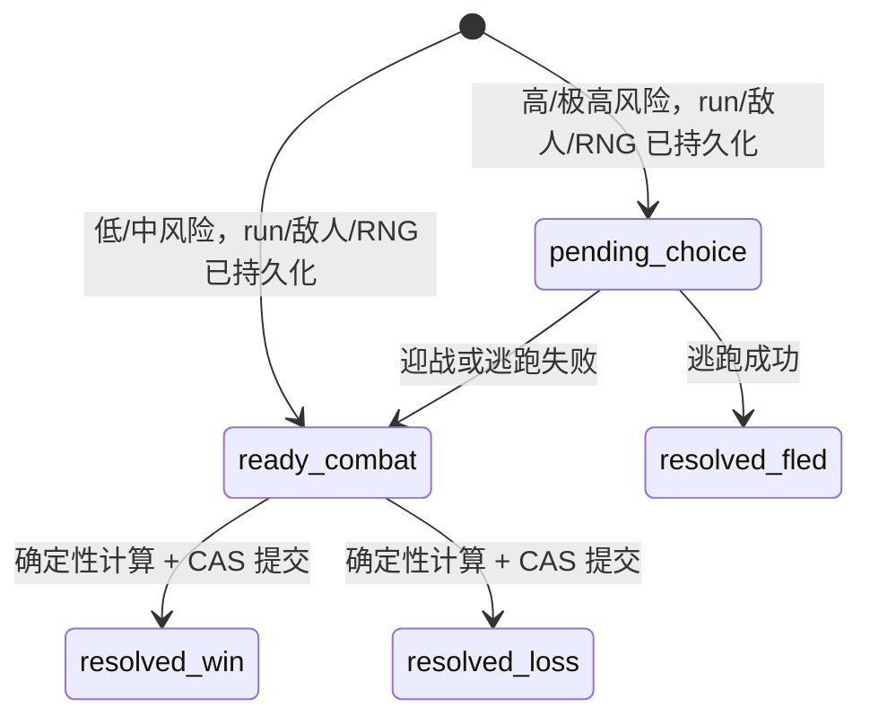

# Technical Design: 普通 PVE 持久结算与逃跑疲劳

## 1. State machine

低/中风险跳过 `pending_choice`，但绝不跳过持久 settlement。`adventure_run_id` 在历练开始时生成并唯一；历练完成后所有档位先原子固化 enemy id/profile version、路线基础收益、玩家/敌人 combat snapshot、RNG seed/结果和 `ready_combat`/`pending_choice` 状态，再做后续计算。终态条件更新阻止重复消费。

## 2. Persistence and transaction

使用持久化/事务基座在 v36 冻结的专用 PVE settlement/effect/fatigue schema 与 transaction-joining repository，而不是扩展 `EncounterStore` 或在本 child 再改 migration/fresh DDL。每个风险档都由 `adventure_run_id` 唯一；生成时锁定敌人、combat snapshot、幂等键和 RNG，并保留历练 busy。首版 `pending_choice` 不自动过期，所有非终态都阻止新历练和空闲回血。

Combat engine 在事务外对不可变快照与固定 RNG 做纯计算；不持久化容易因进程崩溃卡死的 `resolving_combat`。短写事务以 `WHERE state='ready_combat' AND version=?` CAS 原子写入玩家 current HP、路线基础收益领取标记、疲劳、busy clear、终态事实和 effect outbox；CAS 失败读取已提交结果或重新从同一快照确定性计算，绝不重掷 RNG。若实现选择 lease 状态替代无 `resolving_combat` 方案，则必须有持久 owner/lease expiry、stale reclaim 和等价故障测试，不能留下永久中间态。

所有 RNG 结果（enemy、flee roll 或其可重演 seed）进入 settlement，使请求重试确定性。`(adventure_run_id, effect_type)` 对路线收益、悬赏与师承进度建立唯一 effect 记录；当前 `main.py` 的终态响应外置推进要迁入可幂等消费 seam，response replay 只渲染已提交结果，不重新执行效果。

## 3. Flee function

函数接受玩家/敌人身法并返回设上下限的概率；性质测试保证敌我差值增大时不下降。先在设计模拟器中跑地板/标模/天花板，参数未被用户确认时配置保持禁用/缺失即报错，不能偷偷采用默认常数。

## 4. Fatigue and time

疲劳用绝对结束时间作为权威，仅实际 `resolved_loss` 延长 600 秒。fatigue timestamp 使用持久化基座已声明并登记的 `TIME_SKIP_ENTRIES` provider；本 child 负责证明领域写入与 provider 字段一致。pending 首版无 expiry。busy 保持/clear 与 settlement 消费顺序必须在重启和故障注入测试中验证。

## 5. Compatibility

历练普通 PVE 采用新 settlement。秘境兽/传承守护只共享 Health Domain 和 Fighter mapper，保持现有显式交互，不自动获得历练逃跑/路线收益。

## 6. Tests

状态机全路径、所有风险档 run 唯一性、并发双击、进程在计算前/后和 CAS 前/后崩溃、stale 请求恢复、终态 response replay、路线/悬赏/师承 effect 幂等、异常回滚、RNG 重试确定性、逃跑性质/模拟、25%保底、600s/time-skip、三类敌人统计验收和专项组 current HP 回归。
