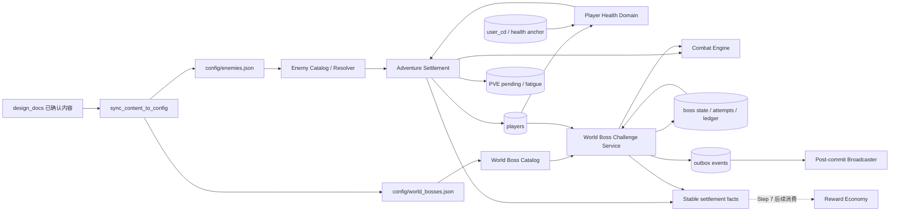
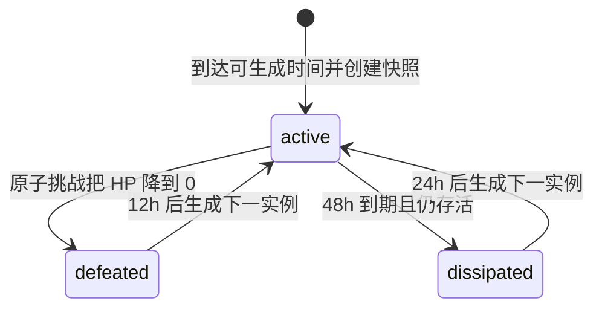

# Technical Design: PVE 怪物与世界 Boss 重做总规划

## 1. 设计目标与边界

本设计把 `design_docs/content-design/pve-enemy-design.md` 已确认的 Step 0–6 转换为可独立实现和验收的工程边界，覆盖：

1. 玩家 `base_hp` / `current_hp` / 动态 `max_hp` 三层气血；
2. 28 只普通 PVE 固定名册与现有秘境兽/传承守护兼容；
3. 普通 PVE 持续气血、持久疲劳和高/极高风险战前逃跑；
4. 4 只世界 Boss 的固定出生快照、生命周期、每日次数、贡献台账和阶段；
5. 提交后事件、迁移、质量门与集成上线。

Step 7 正式奖励经济不在本次实现范围。本次只产出以后可安全消费的稳定结算事实，不写临时掉落、材料、丹药或世界 Boss 分账数字。

## 2. 总体架构



原则：

- 内容档案、领域规则、存储状态和适配器分层，不允许 handler/manager 再散落推导敌人数值。
- 玩家气血只有 Health Domain 能解释；普通 PVE 与世界 Boss 通过它读取动态上限、写回当前值。
- 世界 Boss 战斗对短读不可变快照与固定 RNG 在事务外纯计算；所有最终校验和数据库变更在一个短 `async with db.transaction() as txn:` 中以 version/CAS 提交，外部广播只在提交后发生。
- 所有等待/冷却/生命周期到期字段由字段属主声明并登记 `TIME_SKIP_ENTRIES`。health recovery anchor、PVE pending、北京日期键不登记；当前 GM `/时间快进` 只前移 registry SQL 字段、不改变业务时钟，须验证它不修改 anchor、不额外恢复或重置当日次数；经过量与跨日另由可注入业务时钟测试。

## 3. 数据与领域契约

### 3.1 玩家气血

权威语义：

- `base_hp: int`：永久基础气血；突破只增长该值。
- `current_hp: int`：数据库持久化的当前气血资源；战斗、恢复和药品只改变该值。
- `max_hp: int`：运行时从 `base_hp` 加装备、功法和其他有效加成计算出的最终上限，不另存冗余列。

旧 `Player.hp` 删除且不提供 alias。`get_total_attributes(...)` 和所有调用者要显式使用 `base_hp` 或结果中的 `max_hp`，避免新旧语义混用。

迁移同时修改 fresh schema 与增量链：

- 将旧 `players.hp` 的值迁至 `players.base_hp`；
- v35 优先 rename `players.hp`→`base_hp` 并 add `current_hp`、`health_recovered_at`；现有玩家由迁移检查点的一次性 backfill 读取装备/功法等有效加成，初始化为迁移瞬间动态 `max_hp`，不得延迟到普通首次读取；
- 新玩家 `base_hp` 和 `current_hp` 由创角契约显式初始化；
- Persistence child 独占连续 v36…vN 及每版 fresh DDL parity；C/D 只消费共享 schema/repository。覆盖 v34→latest 不 reset、版本只在成功后推进、重复启动和旧数据加载测试。

Health Domain 提供单一入口完成：动态上限计算、`current_hp` clamp、空闲恢复惰性结算、战后写回和展示快照。由于 `user_cd` 每用户只有一行，不能事后重建活动区间；所有 `BusyState.set_busy(...)` / `clear(...)` 及权威旁路必须在状态转换前按旧状态结算并推进持久锚点。idle 才按每个完整/折算分钟恢复 `1% * max_hp`，busy 只推进锚点；不能用常驻 per-player 定时器，也不能只读 `players.state` 镜像。

### 3.2 普通敌人目录

`config/enemies.json` 的新 schema 必须能无损承载 `design_docs/content-design/enemies.csv` 的 28 只固定档案：稳定 id、段位、类别、名称、五维、技能、词条和必要展示元数据。运行时装载后建立按稳定 id 和 `(realm_segment, category)` 的索引。

敌人解析器接收玩家境界/场景和可选固定 enemy id，返回完整不可变 combat profile；调用方不得自行乘系数。`pve.difficulty_multiplier` 只作用于伤害，不改变 HP、护甲、身法或迅捷。

现有 `spawn_enemy_from_group(...)` 的秘境兽/传承守护数据源继续保留，但输出统一的 combat profile，使三类入口复用 Fighter 映射与测试。新固定名册不得破坏专项组的显式选择。

### 3.3 普通 PVE 结算与逃跑

普通 PVE 分成“生成稳定遭遇”与“消费结算”两段：

1. 所有风险档在历练开始生成唯一 `adventure_run_id`；历练完成时都先持久化 settlement、enemy/profile、路线收益、combat snapshot 和固定 RNG。低/中风险进入 `ready_combat`，不得走无记录同步旁路；
2. 高/极高风险进入 `pending_choice`；首版不自动过期；
3. 玩家只能对该 pending 选择一次迎战或逃跑；重启后仍可恢复；pending 期间保留历练 busy 并阻止新历练和空闲回血，终态消费用条件更新或事务锁保证一次性并原子 clear busy；
4. 逃跑成功不创建战斗/击败/失败事实，保留 `current_hp`，路线基础收益照常；逃跑失败使用 pending 中同一 enemy id 立即开战，不可重掷或重试；
5. 逃跑概率实现为单调有界、可配置且可独立模拟的身法关系函数，参数只有在地板/标模/天花板模拟回写权威设计后才进入配置。

疲劳从 `AdventureManager._route_cooldowns` 搬到持久字段/表。只有实际战败追加 600 秒；战败后 `current_hp = max(current_hp_after_battle, ceil(0.25 * max_hp))`。pending 首版无自动过期；疲劳结束登记 GM time-skip。恢复锚点不是 expiry、不登记 SQL 字段快进；当前 `/时间快进` 只前移注册字段，不改变业务时钟，因此不会额外制造空闲恢复。恢复经过量与跨日行为分别用可注入业务时钟测试。

路线上收益与战斗事实通过明确的 settlement result 传回；本次只保留现有路线基础收益，不引入 Step 7 新奖励。

### 3.4 世界 Boss

#### 内容快照

`config/world_bosses.json` 承载 4 只固定档案。生成活动实例时复制不可变出生快照（profile id/version、名称、境界、最大 HP、五维、技能和阶段规则）到实例，活动期间不因配置热更新重算。

难度倍率与普通 PVE 同义，只乘伤害。不得复用旧的 level/exp 随机推导或即时奖励字段。

#### 生命周期

实例状态机：



终态转换用条件写保证唯一；末击者只由把 HP 从正数降到 0 的事务产生。`expires_at`、`next_spawn_at` 等绝对时间戳登记 time-skip。

#### 原子挑战服务

一次挑战采用短读/锁外计算/短写 CAS：

1. 短读实例与玩家不可变快照、版本、次数视图和由 challenge id 派生的固定 RNG；
2. 在数据库写事务外运行 CombatEngine；
3. 短写事务重新验证实例仍 `active` 且未过期、北京日次数与 instance/player health version；过期则原子转 `dissipated`，CAS 冲突则按同一 challenge id 有界重算或返回明确冲突；
4. 只有成功 CAS 扣次数，并以提交时 `hp_before - hp_after` 记录本场真实伤害；
5. 原子写回 Boss HP、玩家 `current_hp`、按玩家累计贡献、挑战明细、阶段变化、唯一末击和终态；
6. 一次攻击 phase1 跨 60%/20% 时按 phase2→phase3 插入两条唯一业务事件；其他阶段/击杀/消散同样先写唯一 event，提交后展开 per-destination delivery。

阶段由剩余 HP 比例确定：60% 与 20% 阈值；阶段 2 伤害×1.10，阶段 3 伤害×0.90/护甲×0.50。阈值只前进不回退，阶段事件每实例每阶段至多一条。

数据表可按职责拆为实例、daily attempts、贡献/挑战 ledger 和 outbox；最终字段名由子任务实现设计固定，但必须有稳定 instance id、日期键/用户唯一约束和事件去重键。

### 3.5 稳定结算事实与 Step 7 边界

普通 PVE 至少产出：encounter/settlement id、enemy profile id/version、风险、战斗结果、真实气血差、是否逃跑、是否产生击败事实。

世界 Boss 至少产出：instance/challenge id、profile version、玩家、真实伤害、贡献累计输入、阶段变化、是否末击、终态及时间。

这些事实可被后续奖励服务幂等消费；当前任务不创建正式 reward claim，不发放新材料/丹药/掉落/分账，也不保留旧 `stone_reward` 行为作为临时替代。

## 4. 内容同步与治理

新增 enemies/world_bosses 的同步 adapter 和 schema 校验，但保持双闸门：

1. `design_docs/` 中内容必须先由用户确认并标为可同步状态；
2. 只有明确执行 `scripts/sync_content_to_config.py` 才写 `config/`。

当前 CSV 为 `status=draft`、`narrative_status=占位`，因此规划和 adapter 可实施，但不得在未获用户确认时生成正式运行时配置。正式 adapter 必须校验独立 `combat_status=final`（或等价字段）及 approval manifest；manifest 绑定 CSV SHA-256、获批数据集/列范围和叙事决策。战斗数值可单独批准，叙事占位不得被整表状态隐式放行；draft/缺 manifest/hash 漂移/列范围越权均 fail closed。同步必须稳定排序、确定性输出、校验 28+4 数量/唯一 id/枚举/数值边界/阶段阈值，并有 golden/schema 测试。

## 5. 事务、并发与幂等

- 多语句写入统一用 `DataBase.transaction()`；底层 `BEGIN IMMEDIATE` 已负责同任务 join 和跨任务串行。
- 现有会逐方法 commit 的 boss CRUD 必须提供可参与外层 transaction 的数据操作，禁止 challenge service 中间提交。
- pending PVE 消费、世界 Boss 挑战和 outbox event 各有调用级幂等键；重试返回已提交结果或明确冲突，不重复扣次数、伤害或广播。
- 网络/平台发送不在 DB 事务内 await。唯一 business event 提交后展开唯一 `(event_id, platform, group_id)` delivery；逐 destination 条件 claim 隔离 partial success。若平台 API 不支持端到端 exactly-once，则区分“已知未发送”（可安全重试）与“请求已发但结果不确定”（标记 uncertain、禁止自动重试）；后者只能由管理员接受潜在重复风险后人工重放，已 sent destination 不因其他目标失败而重播。测试覆盖并发 worker、进程在 claim/发送/标记各点崩溃和网络异常，不能伪称 exactly-once。

## 6. 模块边界与复用

建议由 children 固化以下深模块：

- Player Health Domain：唯一解释和变更玩家持续气血；
- Enemy Catalog/Resolver：唯一完成固定名册选择和 combat profile 组装；
- Adventure Settlement Service：唯一拥有 pending、逃跑、疲劳和普通 PVE 原子结算；
- World Boss Challenge Service：唯一拥有生命周期和一次挑战的原子状态转换；
- Post-commit Event Dispatcher：只消费已提交事件，不参与领域事务。

Handler 只做输入解析、调用领域服务和格式化输出。Combat engine 继续负责确定性回合战斗，不获得数据库写权限。

## 7. 测试策略

### 单元/契约

- `base_hp` 聚合、动态 `max_hp`、current clamp、空闲区间恢复和属性下降；
- 固定目录解析、只乘伤害、Enemy→Fighter 完整映射、专项组兼容；
- 逃跑概率单调/上下界、同敌人锁定、pending 单次消费；
- Boss 阶段阈值、真实伤害差、北京日边界、生命周期转换和事件去重。

### 数据库/迁移

- fresh schema、v34 升级、重复启动；旧 HP 值保全且无 `hp` alias；
- 疲劳/pending/次数/ledger/outbox 在重启后保持；
- 并发挑战只扣合法次数、HP 不为负、只有一个末击、贡献不重复；
- 事务注入异常时全量回滚。

### 集成/回归

- 普通 PVE、秘境兽、传承守护三条入口；创角、突破、装备、丹药、商店、GM、PvP 和显示消费者；
- Boss spawn→challenge→阶段→defeated/dissipated→respawn；广播失败与重试；
- GM time-skip 覆盖疲劳与 Boss expiry/respawn 到期字段；health anchor、pending、北京日期键不注册，实际 SQL 字段快进不改变恢复量/当日次数；恢复经过量和跨日另用可注入业务时钟验证，pending 以 busy 状态跨重启恢复；
- 设计模拟器/运行时使用相同标模口径，验证 TTK、胜率和逃跑函数参数。

每个代码 child 通过 AstrBot 根目录质量门：

```bash
uv run ruff format .
uv run ruff check .
uv run python -m pytest tests/ -v
```

真实 webtest 仅在用户明确要求时运行。

## 8. 上线与回滚

项目尚未上线，因此采用一次性明确迁移，不保留双写或长期兼容 alias。集成顺序为：气血基座 → 内容 adapter/目录 → 普通 PVE → 世界 Boss → 全消费者/迁移回归。

在内容同步前做用户确认检查；在启用新 Boss 轮询前停用旧随机生成和旧即时奖励路径。回滚优先恢复代码并从数据库备份恢复，因为删除 `hp` alias 后不承诺新旧版本同时读写；迁移子任务须给出备份、校验与失败恢复步骤。

## 9. 关键风险与对策

| 风险 | 对策 |
|---|---|
| `Player.hp` 消费者遗漏导致永久属性或当前血条错写 | 禁止 alias；全仓静态搜索 + 跨功能回归；Health Domain 单写入边界 |
| 内容 draft 被误同步 | 用户确认 + 显式 sync 双闸门；当前 child 只实现 adapter/schema |
| 逃跑公式未封板 | 先提供模拟与配置槽；参数回写设计后才启用高/极高风险交互 |
| pending 造成收益重复领取 | 持久状态机、幂等键、同事务消费路线 settlement |
| Boss 并发超扣/重复末击 | `BEGIN IMMEDIATE` 事务、条件终态更新、唯一约束和并发测试 |
| 广播与事务耦合 | 提交后 outbox；网络发送不持数据库锁 |
| Step 7 被临时奖励渗透 | 删除旧即时 Boss 奖励调用；只输出稳定事实和明确占位接口 |
