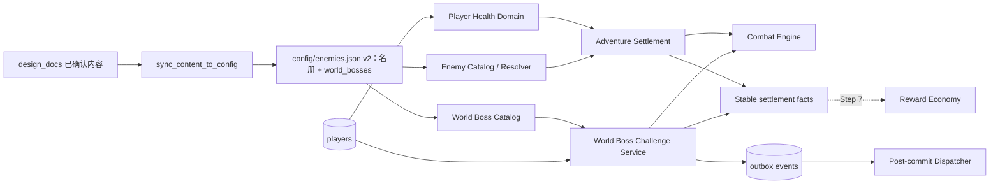

# Technical Design: PVE 怪物与世界 Boss 重做总规划

## 1. 目标与边界

把 `design_docs/content-design/pve-enemy-design.md` 的 Step 0–6 转换成可独立实现与验收的工程边界，覆盖：玩家三层气血、固定名册运行时、普通 PVE 结算与逃跑、世界 Boss 生命周期、内容同步与激活。Step 7 奖励经济不在范围内。

## 2. 总体架构

原则：

- 内容档案 / 领域规则 / 存储状态 / 适配器分层，handler 与 manager 不再散落推导敌人数值。
- 玩家气血只有 Health Domain 能解释；普通 PVE 与世界 Boss 经它读写当前值。
- 世界 Boss 用「短读不可变快照 + 事务外固定 RNG 计算 + 短写 CAS」；广播只在提交后发生。
- 等待/冷却/到期字段由属主声明并登记 `TIME_SKIP_ENTRIES`；气血恢复锚点、PVE pending、北京日期键不登记。

## 3. 契约归属（单点事实表）

同一事实只在一处定义，其余文档引用；改动只改定义处。

| 事实 | 唯一定义处 | 其它位置 |
|---|---|---|
| 三层气血语义与恢复口径 | 父 R2 + child A 已交付 | E1 复核 |
| 地板公式与单源 API | **E1 R1/design §2** | D R4、父 AC4/AC5 引用 |
| 暴击物化（`combat.base_crit_rate`、双侧接线、取值通道） | **E1 R2/design §2** | D R4 引用（世界 Boss 载体） |
| 固定名册 schema v2 与映射契约 | child B（已归档） | D/E2 引用 |
| 世界 Boss `spawn_epoch`/`next_spawn_at`/强制生成/返回契约 | **D R1** | E2 R3 引用 |
| 世界 Boss 事件、叙事门控、outbox 恢复窗口 | **D R7** | E2 R1 引用（写法） |
| 旧 Boss 整删清单、`key=top`、激活顺序 | **E2 R2/R3** | 父 R7、D 依赖引用 |
| 叙事批准与 manifest 形状 | **E2 R1** | D R7 引用（门控字段） |
| 机械清理判据 | **`scripts/audit_pve_redesign.py`** | 各 child AC 只写「跑脚本 → 0」 |

## 4. 跨 child 不变式

1. 气血：`base_hp` 永久、`current_hp` 资源、`max_hp` 运行时；旧 `hp` 无 alias。
2. 难度：`pve.difficulty_multiplier` 只乘伤害；敌人面板来自不可变 profile/快照。
3. 地板：败场 `max(引擎终值, ceil(1% × 动态 max_hp))`，胜场不保底；世界 Boss 每场按败场口径（含末击场）。
4. 实例：世界 Boss 出生快照不可变；同一时刻至多一个 active；`instance_id` 由 `(profile_id, spawn_epoch)` 派生。
5. 事务：多语句写在 `db.transaction()` 内；条件写失败立即 `txn.abort()`；网络 await 不在事务内。
6. 事件：业务事件唯一，per-destination delivery 幂等；不承诺接收端 exactly-once。
7. 内容：未获用户批准不得写正式 config；文案是否放行由 approval manifest 决定。

## 5. 模块边界

- Player Health Domain：唯一解释与变更持续气血；
- Enemy Catalog/Resolver：唯一完成名册选择与 combat profile 组装；
- Adventure Settlement Service：唯一拥有 pending/逃跑/疲劳/普通 PVE 原子结算；
- World Boss Challenge Service：唯一拥有世界 Boss 生命周期与挑战原子转换；
- Post-commit Event Dispatcher：只消费已提交事件；
- Handler 只做解析/调用/格式化；Combat Engine 无数据库写权限。

## 6. 测试策略

- 契约层：气血聚合/clamp/恢复、目录解析、逃跑参数、Boss 阶段与次数、事件去重。
- 迁移/并发：fresh 与 v34→latest、重复启动、并发挑战唯一末击、故障注入全回滚。
- 集成：普通 PVE / 秘境兽 / 传承守护三入口；世界 Boss spawn→challenge→phase→终态→respawn；广播 partial success。
- 时间：GM 时间快进覆盖疲劳与 Boss 到期字段；恢复量与跨日用可注入业务时钟验证。
- 机械清理：`python3 scripts/audit_pve_redesign.py --scope all`（E1/E2 各自的 AC 用它取证）。

## 7. 上线与回滚

未上线，一次性明确迁移、不做双写。集成顺序：气血基座 → 内容 adapter/目录 → 普通 PVE → 世界 Boss → 全消费者/迁移回归 →（内容批准后）激活切流。每次 schema/handler/poller/config 切换前保留同点代码、DB 与 config hash；回滚恢复三者一致组合。

**2026-10-28 决议**：旧 Boss 数据与结构直接放弃，不迁移不归档；旧表/key/实现/测试/配置三元组/`lint_narrative` 脱钩在内容批准后的同一激活检查点整删（含 v40 `DROP TABLE IF EXISTS boss`），回滚走 git revert + 同期备份。

## 8. 关键风险

| 风险 | 对策 |
|---|---|
| `Player.hp` 消费者遗漏 | 禁止 alias + 全仓静态搜索（audit 脚本）+ 跨功能回归 |
| 内容 draft 被误同步 | 用户确认 + 显式 sync 双闸门；未批准只做 adapter |
| 逃跑/疲劳口径漂移 | 参数封板在配置，语义写在设计 §Q4 |
| 世界 Boss 并发超扣/重复末击 | 条件终态更新 + CAS + 并发测试 |
| 广播与事务耦合 | 提交后 outbox，网络不持锁 |
| Step 7 被临时奖励渗透 | 只输出稳定事实；旧即时奖励随 E2 删除 |
| 文档与实现漂移 | 事实单点化（§3）+ 判据脚本化，不再在文档抄代码快照 |
