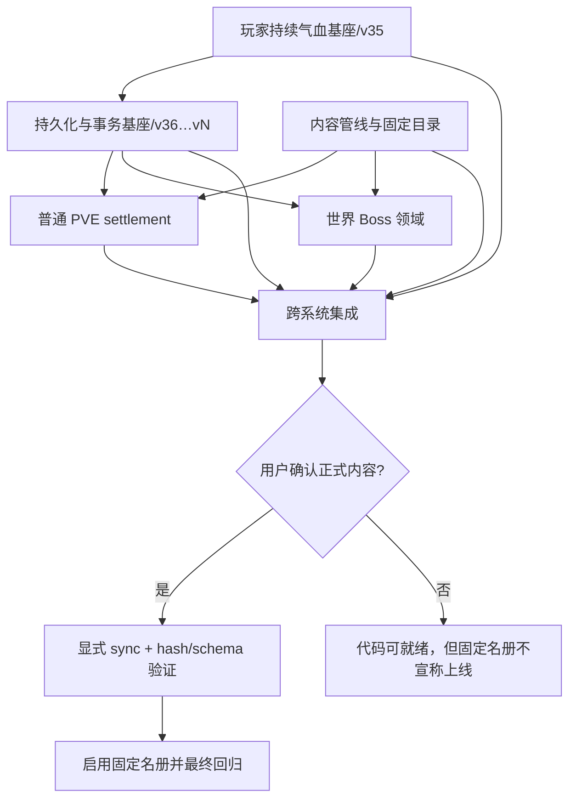

# Implementation Plan: PVE 怪物与世界 Boss 重做总规划

## 1. 执行原则

父任务只负责源需求、依赖顺序、跨 child 验收和上线门，不承载一锅端产品代码。所有 children 当前保持 `planning`；只有用户审批本规划后，才按 Trellis Phase 2 对具体 child 执行 `task.py start` / `trellis-before-dev`。

代码实施批准与内容同步批准是两个不同动作：即使 adapter 已完成，`design_docs/content-design/enemies.csv` 和 `world_bosses.csv` 仍为 draft/叙事占位时，也不得自动写入正式 config。

## 2. Children 与父要求映射

| 顺序 | Child | 覆盖父要求/AC | 主要产物 | 独立回滚点 |
|---|---|---|---|---|
| A | `10-10-pve-player-health-foundation` | R2；AC2 基座 | v35、`base_hp/current_hp/max_hp`、全 HP 消费者、Health Domain、空闲恢复 | schema 切换前 DB 备份 |
| B | `10-10-pve-enemy-catalog-runtime` | R1/R3；AC3 | 内容 validator/adapter、固定 catalog、统一 profile/Fighter mapper | 正式 sync 前 config 不变 |
| P | `10-10-pve-persistence-transaction-foundation` | R4–R7 的共享数据基座 | v36…vN、fresh parity、事务叶子审计、settlement/Boss/outbox schema、time-skip matrix | 领域 handler/poller 接线前 |
| C | `10-10-pve-adventure-settlement` | R4；AC4 | pending、逃跑、current HP、1%战败保底（胜场不保底）、全局疲劳、settlement facts | Adventure handler 切流前 |
| D | `10-10-pve-world-boss-domain` | R5/R6；AC5/AC6 | 四段全随机固定实例、生命周期、北京日次数、HP 地板保底 1%（Q4 统一下调）且无疲劳/入场费、原子挑战/台账、outbox | Boss poller/handler 切流前 |
| E | `10-10-pve-cross-system-integration` | R7；AC1/AC7 及全部跨层关闭 | 组合复核、旧路径退役、poller/time-skip/广播/文档/上线门 | PVE/Boss/sync 四级检查点 |

Step 7 奖励经济不是 child；只由 C/D 输出稳定事实，待正式秘境设计完成后另建 Trellis 任务。

## 3. 依赖图

A 与 B 可并行；A 的 v35/Health 契约稳定后执行 P，P 与 B 均通过后 C 与 D 可并行；E 最后执行。这样避免 C/D 并行争改 `LATEST_DB_VERSION`、fresh DDL、commit 叶子和 time-skip registry。

## 4. 执行批次与门

### Batch 0 — 规划审批

- 审批本父 PRD/design/implement 和六个 child 工件。
- 不启动实现，不运行内容 sync。

### Batch 1 — Foundations (A + B)

- A 完成 v35、Health Domain 和所有现有 HP 消费者机械迁移，独立质量门为绿；不得把不可运行的字段迁移红态留给 E。
- B 完成 adapter/catalog/profile，并用真实只读 CSV 渲染内存/临时 preview 做 28+4 四层验证；未经单独确认不覆盖正式 config。
- Gate 1：A/B 各自 AC、定向测试与完整质量门通过；profile 和 Health API 冻结。B 的 preview 通过不等于正式内容已批准，正式 generated config 复验仍在 Batch 5。

### Batch 2 — Persistence and transaction foundation (P)

- 冻结 v36…vN 连续迁移、fresh parity、PVE/Boss/outbox 最小表、transaction-joining repositories 和 time-skip provider matrix。
- 审计事务入口到叶子的裸 commit，并以故障注入证明 player/busy/settlement/attempt/ledger/outbox 全量回滚。
- Gate 2：v34→latest 不 reset、版本仅成功后推进；schema/repository/CAS/idempotency/registry 契约冻结。

### Batch 3 — Gameplay domains (C + D)

- C 完成可重启 ordinary PVE settlement。逃跑函数参数必须先模拟、回写权威设计并获得确认，才能启用高/极高风险选择。
- D 完成 Boss 状态机/挑战/台账/outbox，不发放 Step 7 奖励。
- Gate 3：状态机、并发、异常、restart/time-skip 测试通过；无旧即时奖励渗透。

### Batch 4 — Integration (E)

- 复核 A 已完成的全消费者迁移；在 disabled/fixture 状态接线新 PVE/Boss 入口并验证“停旧→启新”的原子 cutover 机制、跨玩法与 per-destination 广播，但在正式内容未批准前不执行生产入口切流。
- 更新架构、状态、README/API 文档。
- Gate 4：产品代码旧语义清零且旧入口已具备可执行退役清单，新入口在未批准内容下保持 disabled；完整 ruff/pytest 通过。真实 webtest 仍不运行，除非用户明确要求。

### Batch 5 — Content approval and activation

- 向用户展示最终 28+4 CSV 的 combat approval 状态、`narrative_status`、批准 manifest/hash/列范围、逃跑参数和生成 diff。
- 用户明确确认后才运行 `scripts/sync_content_to_config.py`。
- 新 adapter 仅接受 `combat_status=final`（或等价独立战斗数值批准字段）+ 显式 CLI approval manifest；校验 count/id/schema/hash 后，在同一激活检查点停用旧普通 PVE/Boss 入口与旧 poller/key、启用新目录/新 lifecycle poller，再执行最终功能回归。叙事可否使用占位内容由 manifest 单独记录批准 hash 与列范围，不得把整份 draft 模糊升 final。
- 若 sync、验证或 cutover 任一步失败，新入口不得启用；按 RP 恢复同一代码/DB/config 组合，禁止旧/new 双运行。
- 若用户暂不确认，任务状态应准确记录为“代码就绪、内容启用门待确认”，旧生产入口维持原状，不能伪装完成上线。

## 5. 父级验收矩阵

| Parent AC | Evidence owner | 必须证据 |
|---|---|---|
| AC1 拆分/依赖/回滚 | 父任务 + E | 6 children 完整工件、依赖图、4级 rollback checklist |
| AC2 HP 迁移 | A + E | v34/fresh/idempotent migration，全消费者静态清零与回归 |
| AC3 28只四层一致 | B + E | B：真实 CSV→临时 preview→profile→Fighter golden；Batch 5：正式 generated config 同链路复验；专项组回归 |
| AC4 普通 PVE | C + E | 统计口径、pending/逃跑、1%战败保底、600s/time-skip、restart |
| AC5 Boss 状态/并发 | D + E | 四段全随机且不按玩家适配/不重掷、北京日3次、48h/12h/24h、玩家 HP 地板保底 1%（Q4 统一下调）且无疲劳/入场费、真实damage、唯一末击、并发/重启 |
| AC6 广播/奖励边界 | D + E | 唯一 business event、per-destination partial-success/uncertain 证据、贡献/末击事实、无 Step 7 数值 |
| AC7 质量/治理/文档 | 全部，E 汇总 | 定向+完整ruff/pytest、sync双闸门、文档一致 |

## 6. 总回滚策略

项目未上线，不做长期兼容 alias 或双运行。每次 schema/handler/poller/config 切换前保留同一检查点的代码、数据库备份和 generated config hash；回滚必须恢复三者一致组合。禁止新 schema 配旧代码、旧轮询和新轮询同时运行、或手改 generated config 救火。

## 7. 最终 Definition of Done

- 六个 child 的 AC 全部有证据；父 AC1–AC7 逐项关闭。
- Step 0–6 的运行时与权威设计一致；Step 7 明确未实施。
- 只有在内容另行获批并同步验证后，才能称“固定名册玩法已启用”。
- 完整质量门通过；真实 webtest 仅用户另行明确要求。
