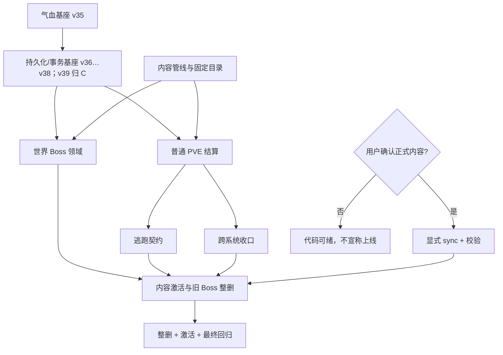

# Implementation Plan: PVE 怪物与世界 Boss 重做总规划

## 1. 执行原则

父任务只管源需求、依赖顺序、跨 child 验收与上线门，不承载产品代码。状态（2026-11-05）：A/B/P/C/F 已归档；D、E1 可开工；E2 待 D/E1 归档 + 用户内容批准。代码实施批准与内容同步批准是两个独立动作。

## 2. Children

| Child | 覆盖 | 主要产物 | 回滚点 |
|---|---|---|---|
| A `10-10-pve-player-health-foundation` ✅ | R2；AC2 基座 | v35、三层气血、全 HP 消费者、Health Domain | schema 切换前备份 |
| B `10-10-pve-enemy-catalog-runtime` ✅ | R1/R3；AC3 | 内容 validator/adapter、固定 catalog、统一 mapper | 正式 sync 前 config 不变 |
| P `10-10-pve-persistence-transaction-foundation` ✅ | 共享数据基座 | v36…v39、fresh parity、事务叶子、settlement/Boss/outbox schema | 领域接线前 |
| F `10-22-adventure-flee-contract-rework` ✅ | R4 逃跑；AC4 | 全风险段 pending、×0.3、不滚掉落/传承 | 单提交 revert |
| C `10-10-pve-adventure-settlement` ✅ | R4；AC4 | pending、逃跑、气血回写、1% 战败保底、全局疲劳 | handler 切流前 |
| D `10-10-pve-world-boss-domain` | R5/R6；AC5/AC6 | 固定实例与出生快照、生命周期、北京日 3 次、原子挑战、outbox | poller/handler 切流前 |
| E1 `10-10-pve-cross-system-integration` | R7；AC1/AC2/AC4/AC7a | 地板单源、消费者复核、暴击双侧接线、事务叶子、文档与版本 | 地板与消费者收口前备份 |
| E2 `10-28-pve-content-activation` | R7；AC3b/AC7b + 激活 | 内容批准/sync、旧 Boss 整删、普通 PVE 切流、原子激活 | 激活前 DB + generated config 备份 |

Step 7 奖励经济不是 child；C/D 只输出稳定事实。

## 3. 依赖图

A/B 可并行；C 与 D 可并行；E1 可与 D 并行（只碰地板/消费者/暴击，不碰 Boss）；E2 在 D、E1 与内容批准之后。这样避免并行争改 `LATEST_DB_VERSION`、fresh DDL、commit 叶子与 time-skip registry。

## 4. 批次与门

- **Batch 0 规划审批**：审批本父文档与各 child 工件；不启动实现、不跑 sync。
- **Batch 1 Foundations（A+B）✅**：三方契约冻结；B 的 preview 不等于内容批准。
- **Batch 2 Persistence（P）✅**：v36…vN、fresh parity、事务/幂等/registry 契约冻结。
- **Batch 3 Gameplay（C ✅ / F ✅ / D）**：世界 Boss 状态机、挑战、台账、outbox；不含 Step 7 奖励。
- **Batch 4 E1（可独立关闭）**：地板单源与消费者收口（含宗门入口）、暴击双侧接线、事务叶子清零、文档与版本。Gate 4 = 产品范围 ruff/pytest + `audit_pve_redesign.py --scope e1` 为 0。
- **Batch 5 E2（外部门）**：内容批准 → sync → 整删旧 Boss → 普通 PVE 切流 → 新入口/poller 激活 → 最终回归；任一步失败按 RP 整组回滚，禁止旧/new 双跑。Gate 5 = `audit_pve_redesign.py --scope all` 为 0 + 端到端证据（详见 E2 文档）。

## 5. 父级验收矩阵

| Parent AC | Owner | 证据 |
|---|---|---|
| AC1 拆分/依赖/回滚 | 父 | 8 children 工件、依赖图、回滚点 |
| AC2 HP 迁移与消费者 | A + E1 | v34/fresh/幂等迁移、全消费者静态清零与回归 |
| AC3a 四层一致 | B ✅ | CSV→preview→profile→Fighter golden |
| AC3b 正式 config 生效（外部门） | E2 | 内容批准 + 正式 sync + 同链路复验 + 旧派生运行态不再命中 |
| AC4 地板/疲劳/逃跑 | C + E1 | 三入口地板（含宗门领取）、疲劳与 time-skip、restart；数值回归归 bd `-9u2` |
| AC5 Boss 状态/并发 | D + E2 | 生命周期/次数/真实伤害/末击/CAS；HP 锚 D AC9 + E2 复跑 |
| AC6 广播/奖励边界 | D + E2 | 唯一事件、partial success/uncertain、贡献末击事实、无 Step 7 数值 |
| AC7a 质量/文档 | E1 + E2 | 产品范围 ruff/pytest、`audit_pve_redesign.py` 为 0、文档一致 |
| AC7b 内容双闸门（外部门） | E2 | 独立批准/manifest/hash/列范围、sync 复验 |

## 6. 总回滚

每次切换前保留代码/DB/config hash 同点备份；回滚必须三者一致。禁止新 schema 配旧代码、旧轮询与新轮询同时运行、手改 generated config。

## 7. Definition of Done

- 8 个 child 的 AC 全部有证据；父 AC 逐项关闭；外部门（内容批准、bd `-9u2`）按实际状态记录。
- Step 0–6 运行时与设计一致；Step 7 明确未实施。
- `pytest` 全绿、产品范围 ruff 通过、`python3 scripts/audit_pve_redesign.py --scope all` 为 0。
- 旧 Boss 数据与结构不迁移；旧实现随 E2 激活检查点整删。
